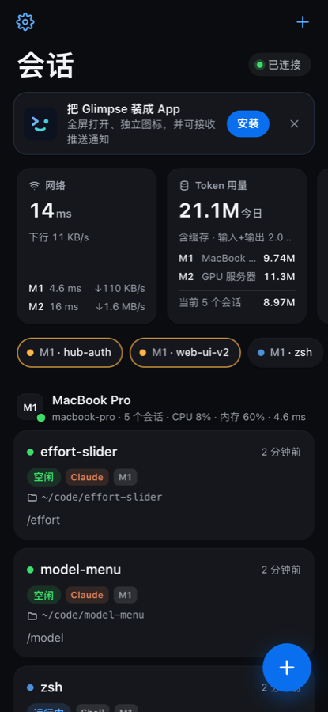
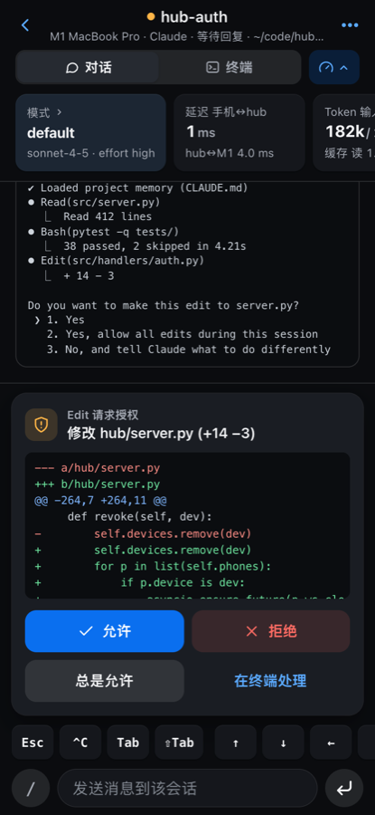
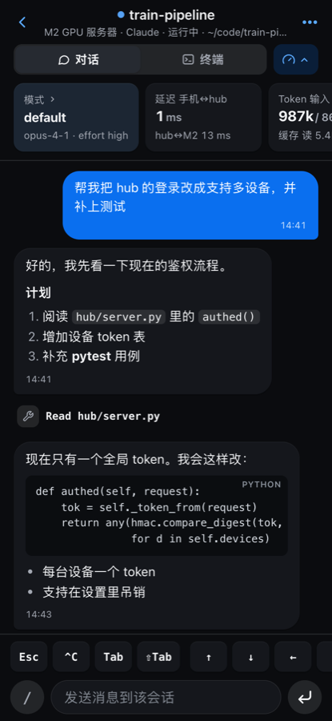
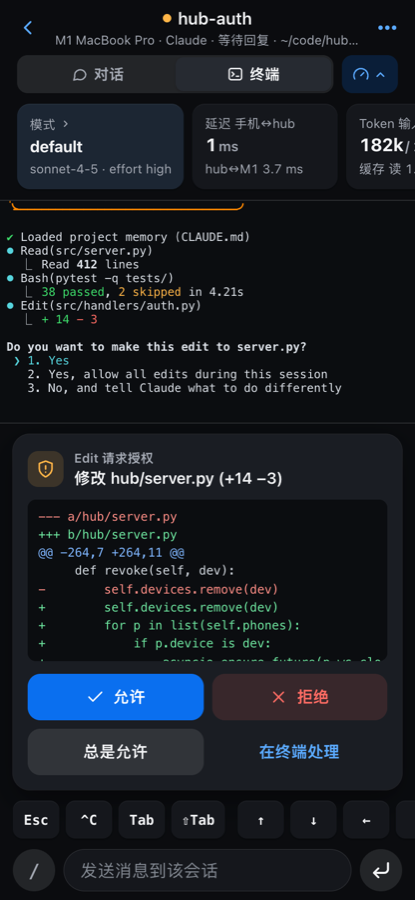
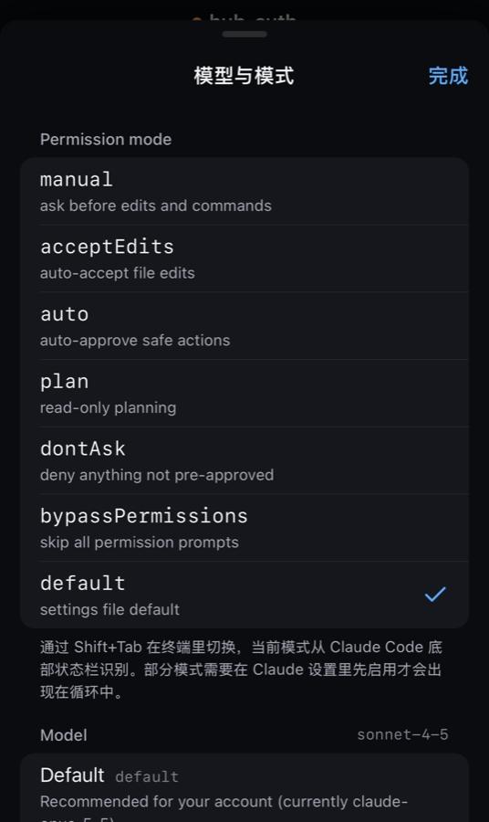
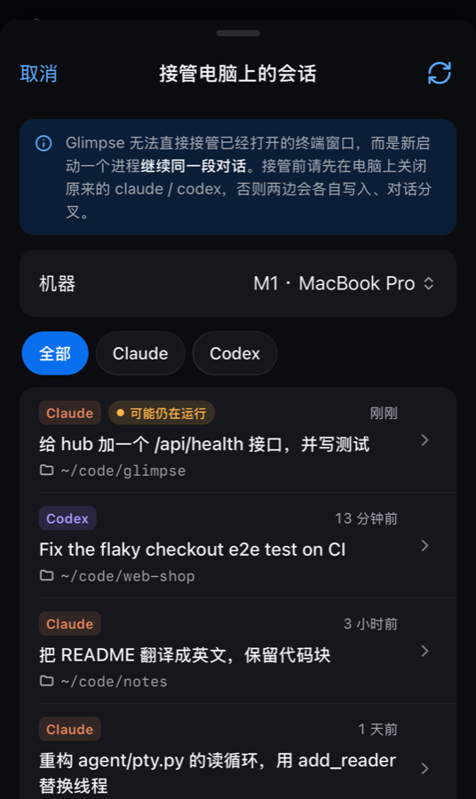
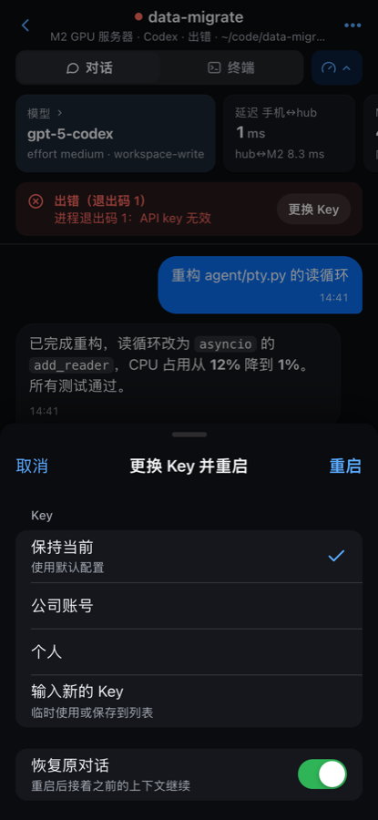
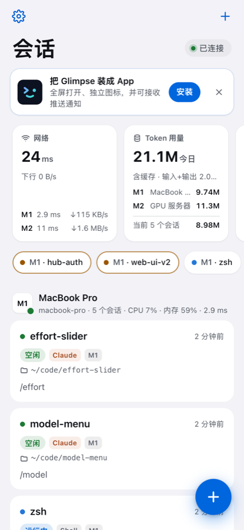
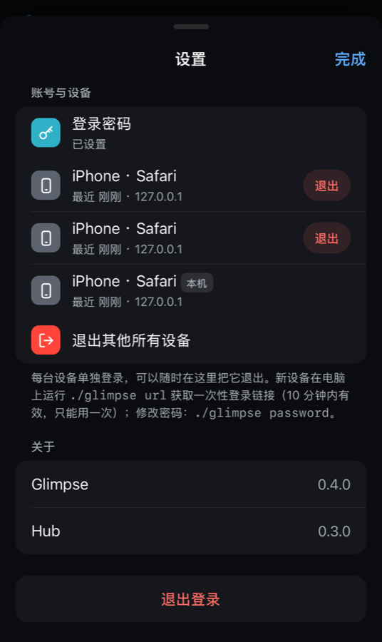

<div align="center">


# Glimpse

<p>
  
  
  
  
  
</p>

**Watch and drive the Claude Code / Codex sessions running on your laptop and dev boxes — from your phone.**

Live output · reply and approve from your phone · push notifications on done / error / question · multi-machine session tabs

**English** · [简体中文](README.zh-CN.md)

[Quick start](#quick-start) · [How it works](#how-it-works) · [Configuration](#configuration) · [Security](#security) · [FAQ](#faq)

   

</div>

## Why

You leave Codex running on your Mac and Claude Code on a dev box, then go out for lunch. How far along are they? Is one stuck on a permission prompt? Did one crash?

Glimpse turns your phone into a remote control for those sessions. What you see on the phone is their real terminal, not a separate sandbox.

## Features

- **Session tabs across machines**: every session from every machine in one list. Each shows the machine id (M1, M2…), task name, working directory, live status and the latest reply.
- **Three views**:
  - **Chat** renders the Claude Code / Codex transcript as chat bubbles, with expandable tool calls and output; Markdown tables, quotes and links are rendered and code blocks are highlighted. Formulas (`$…$`, `$$…$$`, `\(…\)`, `\[…\]`, ```` ```math ````) are typeset with KaTeX and ```` ```mermaid ```` blocks are drawn as diagrams (源码 shows the source; a diagram with a syntax error shows its source). Amounts like "$5 and $10" stay text.
  - **Terminal** is the full terminal screen, rendered with xterm.js.
  - **Files** browses the session's working directory: a folder tree with git status marks, previews of text (line numbers, wrap, syntax highlighting for about 20 languages), Markdown (渲染 | 源码), images and diffs, and a 改动 list of changed files with +/− counts. 引用 puts `@path` into the composer. On a wide screen (≥ 1200 px) the files are a column next to chat / terminal; drag its edge to resize it (double-click for the default).
    - **编辑** edits a text file in place (highlighted, Tab / Shift+Tab indent, ⌘S / Ctrl+S saves). Saving names the version you started from: if the file changed meanwhile (the AI edited it), you are asked before it is overwritten. An unsaved edit survives leaving the session or reloading the page. The file keeps its encoding (UTF-8 or GB18030), line endings and permissions; the write is atomic.
    - **＋** creates a file (opened in the editor) or a folder, missing parent folders included. Nothing is ever deleted or renamed from here.
    - Requests are confined to the session's directory (symlinks out of it are refused). `.git` and Glimpse's own `data/` and `config.json` can't be changed. Files that usually hold secrets (`.env`, keys, credentials) or contain something that looks like a key are listed, but their content is only shown (and editable) after tapping 显示内容.
- **Type from the phone**: messages are submitted to the session's process exactly as if typed. The quick-key bar (Esc, ^C, Tab, arrows, 1/2/3, paste…) is customisable in Settings → 快捷键: turn keys on or off, reorder them, or add your own (`^X`, `\e`, `\r`, `\xNN` escapes). The paste key sends the clipboard as a bracketed paste, and code blocks in chat have a copy button.
- **TUI menus in chat view**: when `/model`, `/effort` or another interactive picker opens in the terminal, chat view shows it as a menu card with large tappable rows (current choice and cursor marked), plus Esc and, for Claude, "s · this session only". A "/" button in the composer types common slash commands (`/model`, `/effort`, `/compact`, `/clear`, `/status`).
- **One-tap approvals**: when Claude Code asks for permission, an approval card offers Allow, Always allow, Deny or Handle in terminal. This uses the official `PermissionRequest` hook, not simulated key presses.
- **Answer questions**: `AskUserQuestion` options show up as buttons. When several questions come at once the card follows them one by one (问题 2 / 3, previous / next) and ends on a submit page with every answer.
- **Push notifications** through standard Web Push when a turn finishes, the agent stops on an error, it needs approval or an answer, or the process exits. A device that has Glimpse on screen gets an in-app banner instead; every other device is still notified (a desktop window counts only while it is focused).
- **Auto-continue** (off by default, per session in 会话操作): when a turn stops on a transient error (`stream disconnected`, `overloaded`, `Service temporarily unavailable`, `Incomplete response … max_output_tokens`, `Connection failed: error sending request`, 5xx…), Glimpse types `继续` after a backoff (15 s, then every 30 s). There is no retry limit: it keeps going until the AI finishes a reply, you send a message yourself, or you switch it off; at the 5th error in a row (and about hourly after that) you get a notification that it is still retrying. Errors you have to fix yourself, such as no balance, invalid key or a full context, are never retried and still notify you.
- **Switch keys without restarting**: Claude Code reads its key through `apiKeyHelper` and Codex (with a custom provider) through the provider's `auth.command`, both from a per-session `0600` file, so a key changed while the session is fine (e.g. balancing) applies without a restart. After a key failed (no balance, rejected) the session is restarted and the conversation resumed instead: Claude Code keeps the key a message started with for all of that message's retries, so a live swap would only help the message after the next one. Other sessions fall back to restart + resume.
- **Key balancing (optional, off by default)**: Settings → Key. *On no balance*: a session whose key runs out or is rejected switches to another key and continues. *By usage*: additionally keeps the keys' 7-day usage percentages close to each other. New sessions go to the key with the lowest percentage; between turns, a session on a key 5 or more percentage points above the lowest one moves to that key (at most once per 30 minutes per session). Percentages are compared as they will be in an hour at each key's spend rate, measured from successive usage polls, so sessions started between two polls don't all land on one key. The 5-hour window is left to *on no balance*. Needs `keys.usage_url`; without it sessions are spread evenly by count. Exclude keys you don't want picked.
- **Swap key and restart**: when an API key runs out of credit, pick another one on the phone. Glimpse stops the old process, starts a new one and resumes the conversation (`claude --resume` / `codex resume`).
- **Model & mode controls**:
  - The pickers show the real lists from each machine. Codex models and their efforts come from `codex debug models`; Claude models are default / opus / sonnet / haiku / fable / opusplan, with the custom names from your `--settings` file. Lists are cached for 10 minutes.
  - Claude Code: permission mode (manual / acceptEdits / auto / plan / dontAsk / bypassPermissions), `/model`, effort (low / medium / high / xhigh / max / ultracode) and `/goal`. `ultracode` starts with `--effort xhigh` and then runs `/effort ultracode`.
  - Codex: model, reasoning effort (low / medium / high / xhigh / max / ultra, as supported by the model), approval policy and sandbox. Applied inside the running session through Codex's own `/model` and `/permissions` (session only, `config.toml` is not touched); only a combination those pickers don't offer restarts Codex and resumes the conversation.
  - All of these can also be chosen when creating a session.
- **Continue a conversation started on the computer**: the "adopt" sheet lists recent Claude / Codex conversations on a machine. Glimpse resumes the one you pick under its control.
- **Delete sessions**: swipe a card left, or use 会话操作 → 删除. A running process is stopped first. There's also one-tap cleanup of finished sessions.
- **Manage machines from the phone**: add, edit, remove and test SSH machines. The hub's existing SSH keys are used, and host names are validated.
- **Group by machine or by status**: the home screen can group sessions by status (needs attention, errors, running, waiting, idle, finished) instead of by machine.
- **Key usage (optional)**: if your keys come from a relay with a usage API, set `keys.usage_url` and the key pickers show each key's quota windows and today's spend, refreshed every 5 minutes. Leave it empty to turn this off.
- **Persistent memory (optional, [AMem](https://github.com/lyfeng001/AMem))**: every Claude Code / Codex session of the same project shares one long-term memory, across sessions and machines. The assistant reads earlier conclusions at the start of a task and saves verified ones (decisions, root causes, handoffs) itself; the full history is captured after every turn and searchable. The injected instructions tell the assistant that the current request and the live repository always outrank memory, and to ignore memories that don't matter for the task. Settings → 记忆 shows storage use against the budget (default 20 GB), each project's saved memories and a search. Beyond the budget the oldest tool output and tool calls are compacted away; memories and conversation are never removed. See [Memory](#memory).
- **Widgets**: network latency and throughput, token usage (including **today's total** per machine, counted from all Claude / Codex transcripts on it), context usage, model & mode, machine CPU and memory, key quota (7-day and 5-hour windows, with `keys.usage_url`), memory storage per machine, the machine's public IP and location with an on-demand download speed test, and session counts. Each can be toggled and reordered. The network widget is the only one that contacts third parties, and only from the machine itself: while it is shown, the machine looks up its IP at `ipinfo.io` (cached 10 minutes), and the speed test downloads 10 MB from `speed.cloudflare.com` when you tap 测速.
- **Drafts survive leaving a session**: text typed in a session's composer and not sent is kept per session on that device.
- **Sessions outlive every connection**: an agent daemon owns the PTYs, the same idea as tmux. Restarting the hub, dropping SSH or locking the phone never stops the AI process. Output resumes from the exact byte offset on reconnect.
- **Updating**: after `git pull`, restart `gli hub`. The daemon on each machine reports which agent code it runs; one that is outdated and has no running sessions is replaced right away. One with running sessions keeps going and shows 需要更新 (Settings → 机器, and the network widget); tapping 更新 restarts it on the new code, Claude / Codex sessions come back under the same id with their conversation resumed, and terminals attached with `gli attach` reconnect by themselves.
- **Laptop and phone together**: `gli run claude` attaches your laptop terminal to the same session. `Ctrl-]` detaches.
- **Themes**: Settings → 外观 switches between follow system, light, dark and Solarized (Warp's Solarized Dark, terminal colours included). The choice is per device. The terminal view stays dark.

<p align="center">    </p>

## How it works

```
 phone / any browser (installed as a PWA)
    │  HTTPS + WebSocket over Tailscale (WireGuard, peer-to-peer whenever NAT traversal succeeds)
    ▼
 hub (an always-on computer, hub/server.py)
    │  one stdio JSON channel per machine: a local subprocess, or ssh for dev boxes (uses ~/.ssh/config)
    ▼
 agent (agent/glimpse_agent.py, Python standard library only)
    └─ runs claude / codex inside PTYs and reads their hooks and transcripts
```

- **Why Tailscale instead of port forwarding or a relay server**: your phone and computer are on the same tailnet and connect directly. Nothing sits in between, latency is roughly the network round trip, and no public port is opened. Tailscale also issues free `*.ts.net` HTTPS certificates, and iOS Web Push requires HTTPS.
- **Nothing to install on dev boxes**: the hub sends the agent source over ssh stdin and `exec`s it in memory, so the agent code is never installed there. The only files it writes are per-session temporary Claude settings files (`0600`, in a private temp dir, deleted when the process exits). The remote only needs `python3` (3.8+) and passwordless ssh. It doesn't need Tailscale either.
- **State detection**:
  - **Claude Code**: hooks injected at launch (`SessionStart`, `UserPromptSubmit`, `PreToolUse`, `PermissionRequest`, `Notification`, `Stop`, `StopFailure`, …). Content comes from the transcript JSONL.
  - **Codex**: the rollout JSONL (`task_started`, `task_complete`, `token_count`, …) plus the terminal's OSC 9 notifications.
- **Only a browser on the phone**: no app store, profile or certificate to install, no jailbreak, no sideloading.

## Quick start

### Requirements

| Device | Needs |
| --- | --- |
| hub (an always-on macOS or Linux computer) | Python 3.9+ and [Tailscale](https://tailscale.com/download), with MagicDNS and HTTPS Certificates enabled in the admin console |
| each dev box | `python3`, and passwordless `ssh <host>` from the hub |
| phone / other devices | the Tailscale app, signed in to the same tailnet. iPhone needs iOS 16.4+ for push; Android and desktop Chrome / Edge / Safari work too |

### 1. Install

One line, on the computer that will be the hub (no sudo; it clones into `~/Glimpse`, creates the Python environment and `config.json`, and puts `gli` on your PATH):

```sh
curl -fsSL https://raw.githubusercontent.com/lyfeng001/Glimpse/main/install.sh | sh
```

`GLIMPSE_REF=v0.4.2` pins a release, `GLIMPSE_DIR` picks another place. Running it again updates the checkout (it stops if you changed files there) and never touches `config.json` or `data/`. To read it before it runs: `curl -fsSLo glimpse-install.sh <same URL>`, look, then `sh glimpse-install.sh`.

Or by hand:

```sh
git clone https://github.com/lyfeng001/Glimpse.git
cd Glimpse
./gli setup            # creates .venv, installs dependencies, creates config.json from config.example.json
./gli install          # optional: puts `gli` on your PATH (symlink in ~/.local/bin)
```

Dev boxes the hub reaches over ssh need no install at all (see Requirements).

### 2. Configure

Edit `config.json` (every field is documented under [Configuration](#configuration)):

- `hub.listen` and `hub.tailscale_hostname` default to `"auto"`, which uses this computer's Tailscale IP and MagicDNS name.
- `keys` and `machines`: your API keys and the machines to monitor. Machines can also be added later from the phone.

### 3. Run the hub

```sh
gli hub                    # foreground; the first start fetches an HTTPS certificate via `tailscale cert`
scripts/install_launchd.sh       # optional (macOS): start at login and restart if it dies
```

The login agent: run `scripts/install_launchd.sh` as yourself, not with `sudo` (a login agent belongs to your user;
one written by root is never loaded). It stops a hub you started by hand and runs it through launchd from then on.
`scripts/install_launchd.sh status` shows whether it runs; restart it with
`launchctl kickstart -k gui/$(id -u)/dev.glimpse.hub`. The hub writes `data/hub.log` as before; launchd's own
output (a crash at start) goes to `~/Library/Logs/glimpse-hub.log`. If Tailscale is not up yet at login, the hub
serves on 127.0.0.1 first and adds the Tailscale address as soon as it is there.

### 4. Open it on the phone

1. Open the Tailscale app and stay connected.
2. On the computer, run `gli url` and open the printed link in the phone's browser. It is a one-time login link: it works once, within 10 minutes. Optionally run `gli password` so devices can also log in with a password.
3. Install it as an app (see [Use it as an app](#use-it-as-an-app)), and from then on open Glimpse from its icon.
4. In ⚙︎ Settings, tap **Enable notifications** and allow them, then tap **Send test notification** to check.

### 5. Start a session

- **From the phone**: tap ＋ and pick a machine, a type (Claude Code / Codex / Shell), a key and a working directory.
- **From the computer**: run `gli run claude` or `gli run codex`. Your terminal attaches to the same session:
  - `Ctrl-]` detaches.
  - `gli attach <id>` re-attaches, and plain `gli attach` picks the latest live session. On the hub computer this also works for sessions on other machines (`gli attach M2:<id>`), through the hub. The phone's 会话操作 sheet shows the exact command and a deep link for any other browser.
  - `gli ls` lists all sessions.
  - Arguments after `--` go to the tool unchanged, e.g. `gli run claude -- --model sonnet`.
  - It uses the machine's preset from `config.json` (argv and default key, the same as the phone). `-k/--key NAME` picks another key, `--key none` uses none. It prints the key name, never its value.
  - `gli run claude --resume <id>` continues a conversation. If a Glimpse session already holds it, you attach to that session (restarted in place if it had exited) instead of getting a second copy.
- **From Finder (macOS)**: run `gli finder-install` once. Then right-click a folder → 快速操作 (or 服务) → **用 Glimpse 新建会话**: the browser opens the new-session form with this computer and that folder filled in. Everything else keeps its default, and nothing starts until you tap 启动. `gli new [PATH]` does the same from a terminal (a file: its folder).
  - The menu entry is `~/Library/Services/Glimpse 新建会话.workflow`; `gli finder-uninstall` removes it. If it doesn't show up, turn it on in System Settings → 键盘 → 键盘快捷键 → 服务 (or 隐私与安全性 → 扩展 → 访达).
  - If Glimpse is installed as a window from Chrome / Edge / Brave (安装 / 创建快捷方式 → 在窗口中打开), the form opens in that window: the action asks the hub over 127.0.0.1 to show it there, then brings the window up (Chrome opens a web app at its start page whatever link it is given, so a link can't do this). The request carries the Quick Action's own token, which can do nothing but this and only from this computer, and the form only ever goes to Glimpse windows on this computer, never to your phone. Without such a window, a link opens in the default browser at the address `gli url` prints.
  - macOS doesn't let Quick Actions read `~/Documents`, `~/Desktop` or `~/Downloads`, so the action runs nothing from this project: the address, the window, the machine id and its token are written into it when you install it (the bundle is readable by you only). Run `gli finder-install` again if they change, and after `gli local-cert`.

- **Shell integration (keep typing your usual commands)**: add one line to `~/.zshrc` (or `~/.bashrc`) on the hub computer:

  ```sh
  eval "$(gli shell-init)"
  ```

  From then on the plain commands run as Glimpse sessions, with your terminal attached and the session visible on the phone:

  ```sh
  codex resume 01a0edaf-75de-7bd2-b706-c991c4118ecb --no-daemon
  claude --resume <id>
  claude
  ```

  - The machine preset is applied: Codex gets the preset key exported, Claude launches with the preset settings file. `GLIMPSE_KEY=key2 codex ...` picks another key for one run.
  - A conversation that already has a Glimpse session is attached to instead of being started twice.
  - Non-interactive uses (`claude -p`, `codex exec`, `--version`, sub-commands like `mcp`, pipes and scripts) run the real program untouched. `GLIMPSE=0 codex ...` or `command codex ...` always bypasses Glimpse.

> A `claude` / `codex` you started directly in another terminal can't be attached as-is, because Glimpse doesn't own that terminal. To continue it, quit it there and pick its conversation in **接管电脑上的会话** on the phone. Glimpse then resumes it with `--resume` / `codex resume`.

## Use it as an app

Glimpse is a Progressive Web App: once installed, it opens full-screen from its own icon with no browser bars, and it can receive push notifications.

| Device | How to install |
| --- | --- |
| iPhone / iPad | open the link in Safari → **Share → Add to Home Screen**. Push needs iOS 16.4+ and must be enabled from the installed app |
| Android | Chrome → **⋮ → Install app** (Glimpse also shows an **Install** button) |
| Mac / Windows / Linux | Chrome or Edge: the install icon in the address bar. Safari on macOS: **File → Add to Dock** |

There is no App Store build. The installed web app *is* the app, and it works the same on every platform, including any computer on your tailnet.

On the hub computer itself you can also install it from `https://127.0.0.1:8443`. The Tailscale certificate only names the `.ts.net` host, so first run `gli local-cert` once: it creates a certificate for 127.0.0.1 / localhost and trusts it in your login keychain (macOS asks for your password), then restart the hub. What gets trusted is a one-off CA that can only vouch for 127.0.0.1, ::1 and localhost (name constraints); its private key is discarded right after signing, so nothing else can ever be signed with it. `gli local-cert remove` untrusts and deletes it.

## Configuration

Every setting, including secrets such as API keys, lives in one file: `config.json`. It is git-ignored and mode `0600`. [`config.example.json`](config.example.json) in the repo is the template.

```jsonc
{
  "hub": {
    "listen": [{"host": "auto", "port": 8443}, {"host": "127.0.0.1", "port": 8443}],   // auto = this machine's Tailscale IP
    "tailscale_hostname": "auto",    // or your-mac.your-tailnet.ts.net
    "caffeinate": true,              // macOS: keep the machine from idle-sleeping while the hub runs
    // "listen": [{"host": "auto", "port": 8443}], "tailscale_hostname": "auto"   <- the defaults
    "push_subject": "mailto:you@example.com",
    "approval_wait_seconds": 600     // unanswered approvals go back to the terminal prompt after this long
  },
  "keys": {
    // one key value; the hub maps it to the right variable per session type
    "env": {"claude": "ANTHROPIC_AUTH_TOKEN", "codex": "OPENAI_API_KEY"},
    "profiles": [{"name": "key1", "value": "sk-..."}],
    "usage_url": ""                  // optional: a key-usage API (POST <url>/limit and <url>/summary, Bearer key); "" = off
  },
  "memory": {"enabled": false, "python": "", "budget": "20G"},   // optional persistent memory, see Memory below
  "machines": [
    {"id": "M1", "name": "mac", "type": "local", "default_cwd": "~/code",
     "presets": {
       "claude": {"argv": ["claude", "--settings", "~/.claude/my-settings.json"], "key": null},
       "codex":  {"argv": ["codex"], "key": "key1"}
     }},
    {"id": "M2", "name": "devbox", "type": "ssh", "host": "devbox", "default_cwd": "~"}
  ]
}
```

**How keys are injected**

- **Claude Code** always starts with a `--settings` file. Glimpse reads your own settings file from the preset and writes the selected key into its `env`. It then adds Glimpse's hooks and saves the result as a temporary file (`0600`, deleted when the process exits). The key never appears in the process environment or on the command line.
- **Codex** gets the key as an environment variable (the equivalent of `export OPENAI_API_KEY=...`), named in `keys.env.codex`. The variable is set after your shell rc files run, so a stale key exported in `~/.bashrc` can't override it. If your Codex setup needs extra flags (e.g. `--no-daemon`), add them to `argv`.

**Editing config.json**: changes to `keys` and `memory` are picked up within a few seconds, no restart needed. Changes to `hub` and `machines` need `gli hub` restarted (sessions keep running).

## Memory

Optional. Glimpse uses [AMem](https://github.com/lyfeng001/AMem) (Python 3.11+) as a separate program and never bundles it.

```sh
uv venv .amem --python 3.13
VIRTUAL_ENV=$PWD/.amem uv pip install "agent-memory-local[mcp] @ git+https://github.com/lyfeng001/AMem.git"
```

```jsonc
"memory": {
  "enabled": true,
  "python": "/path/to/Glimpse/.amem/bin/python",   // the interpreter that has AMem installed
  "store": "",                                     // "" = data/memory (one vault for every project)
  "budget": "20G",                                 // compaction starts beyond this
  "keep_days": 30                                  // records newer than this are never compacted
}
```

A machine can override any field with `machines[].memory` (for example its own `python`).

- **Project identity**: the git `origin` repository name, otherwise the folder name, so the same project on two machines maps to the same memory.
- **Launch**: Claude Code gets the AMem MCP server through `--mcp-config` and the memory instructions through `--append-system-prompt`; Codex gets `-c mcp_servers.amem.*` and `developer_instructions`. Memory tools are pre-approved. Nothing is written into the project directory, and a project that already wires AMem itself (its own `.mcp.json` / `.codex/config.toml`) is left alone.
- **Capture**: after every turn the agent archives the new transcript lines (`amem refresh`) and enforces the budget.

## Security

- **Network**: the hub listens only on the addresses in `hub.listen` (by default the Tailscale IP and `127.0.0.1`), so it is unreachable from the LAN and the internet. Only devices signed in to your tailnet can reach it at all.
- **Login**: every device logs in on its own and gets its own session.
  - New devices log in with a **one-time link** from `gli url` (single use, expires after 10 minutes), or with the **password** you set with `gli password`. A copied old link is useless.
  - Sessions are random 256-bit tokens in an `HttpOnly; Secure; SameSite=Strict` cookie. The hub stores only their SHA-256, and the password only as a salted scrypt hash (`data/auth.json`, `0600`).
  - Settings → 账号与设备 lists every device with its last use and lets you log one out, or all others, instantly. From the computer: `gli devices`, `gli logout ID|all`.
  - Repeated wrong passwords lock that client out for a growing time.
  - WebSocket connections from another origin are rejected, and nothing secret is written to the log.
- **Keys**: the browser only ever sees key names. Key values live in the hub's `config.json` (written atomically, `0600`) and in the temporary launch files. Launch command lines are not sent to the phone either.
- **Agent socket**: the Unix socket is mode `0600`. On Linux, abstract sockets check `SO_PEERCRED` in both directions, so only the same uid can connect and a socket squatted by another user is refused.
- **Adding machines from the phone** only accepts plain SSH host names or aliases. The hub connects with `BatchMode=yes` and its own keys, never with passwords.
- **Files**: everything under `data/` (auth data, VAPID private key, push subscriptions, TLS key) is `0600`. `data/token` is only for tools on the hub computer itself (`gli attach`) and is refused from any other address.

## FAQ

<details><summary><b>Do I install something on the phone or on the computer?</b></summary>

The project runs on the computer (the hub). The phone only needs the Tailscale app and a browser, and dev boxes need nothing at all.
</details>

<details><summary><b>Only iPhone? What about Android or another computer?</b></summary>

Any device with a modern browser that is on your tailnet works: Android, iPad, or another Mac / Windows / Linux computer. Log in with a fresh `gli url` link or your password. Push notifications work on Android Chrome and on desktop Chrome, Edge and Safari as well.
</details>

<details><summary><b>What does the logo mean?</b></summary>

A winking face drawn with terminal glyphs: `>` and a dot as the eyes, the cursor line bent into a smile. A friendly *glimpse* at your terminal from wherever you are.
</details>

<details><summary><b>Is it safe for my iPhone?</b></summary>

Yes. It's a web page added to the Home Screen. There's no profile, certificate, jailbreak or sideloading involved, and deleting the icon removes it completely.
</details>

<details><summary><b>Notifications don't arrive</b></summary>

- You can only enable notifications in Settings when the page was opened from the Home Screen icon.
- Notifications must be allowed in iPhone Settings → Notifications → Glimpse.
- The hub must be on HTTPS: `tailscale_hostname` is set and the certificate was issued.
- While Glimpse is open in the foreground you get an in-app banner instead of a system notification.
</details>

<details><summary><b>Does it keep working when I close my laptop lid?</b></summary>

While the hub runs it holds `caffeinate -i` to prevent idle sleep. Closing the lid still sleeps most Macs unless they're on power with an external display. If you have an always-on Linux box, run the hub there instead.
</details>

<details><summary><b>The approval card vs. the dialog in the terminal — which one wins?</b></summary>

Whichever you answer first. If you tap Allow or Deny on the phone, Claude gets that decision directly. The request goes back to Claude's own dialog if you tap **Handle in terminal**, press any key in the terminal, or leave it unanswered for `approval_wait_seconds`.
</details>

## Development

```sh
gli test                   # unit tests + hub integration tests (incl. the RFC 8291 Web Push vectors)
gli hub -v                 # verbose logging
GLIMPSE_DEBUG=1 gli hub    # the agent logs hook events and launch commands to data/agent/agent.log
```

```
agent/glimpse_agent.py   PTY daemon, hook relay, transcript parsing, CLI (stdlib only, runs in-memory on remotes)
hub/server.py            HTTPS + WebSocket server, auth, push, machine management
hub/machines.py          stdio channel to each machine (local subprocess / ssh)
hub/webpush.py           Web Push (RFC 8291 encryption + RFC 8292 VAPID), no third-party push library
hub/config.py            configuration loading
hub/attach_client.py     `gli attach` through the hub (sessions on other machines)
hub/finder.py            the Finder Quick Action (`gli finder-install`)
web/                     the PWA (vanilla JS + xterm.js, no build step); web/icon.svg is the master logo (PNGs are generated from it)
```

## Acknowledgements

- [xterm.js](https://xtermjs.org/) (MIT) renders the terminal on the phone
- [KaTeX](https://katex.org/) (MIT) and [Mermaid](https://mermaid.js.org/) (MIT) draw formulas and diagrams in chat (vendored, loaded only when a message has one)
- [Tailscale](https://tailscale.com/) provides the network and HTTPS certificates
- The interaction design was inspired by [Moshi](https://getmoshi.app/) and [Happier](https://github.com/happier-dev/happier)

## License

[MIT](LICENSE). The bundled [xterm.js](https://xtermjs.org/) is MIT licensed as well (`web/vendor/xterm.LICENSE`).
