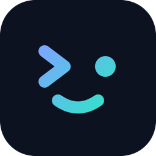
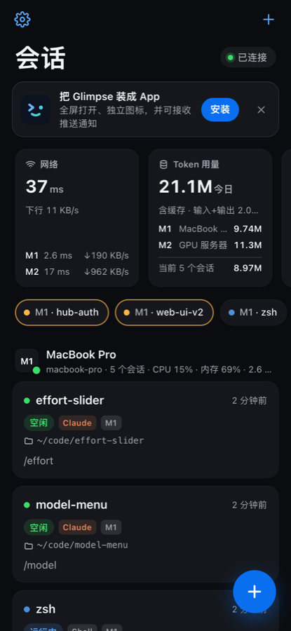
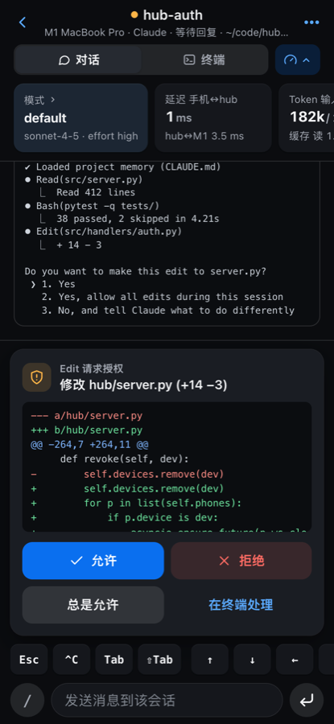
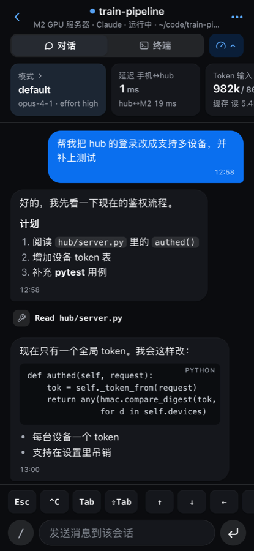
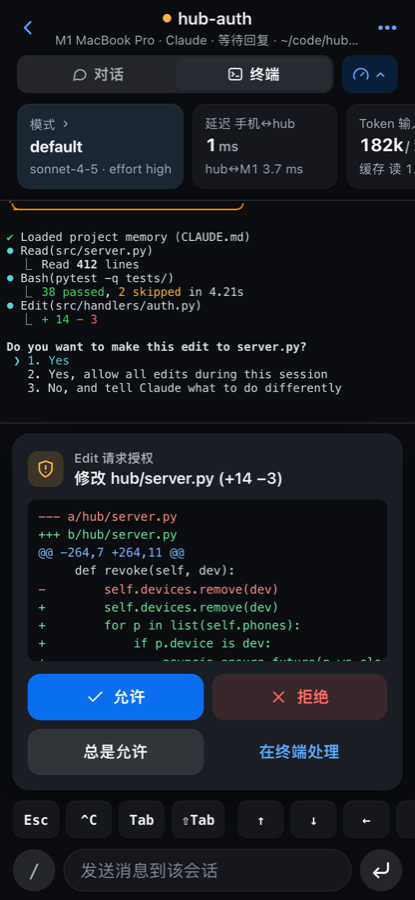
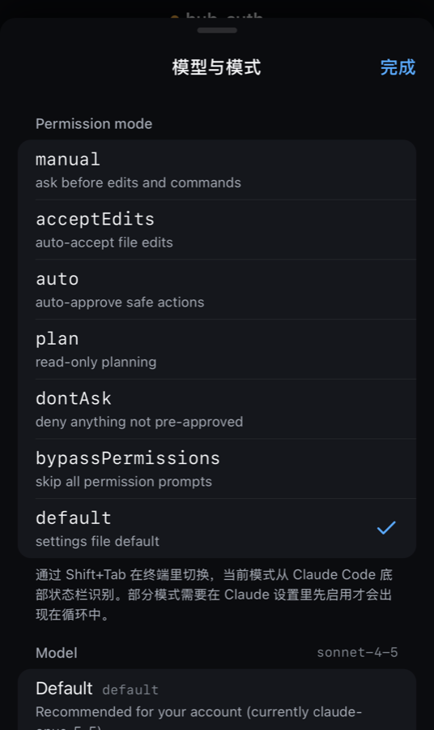
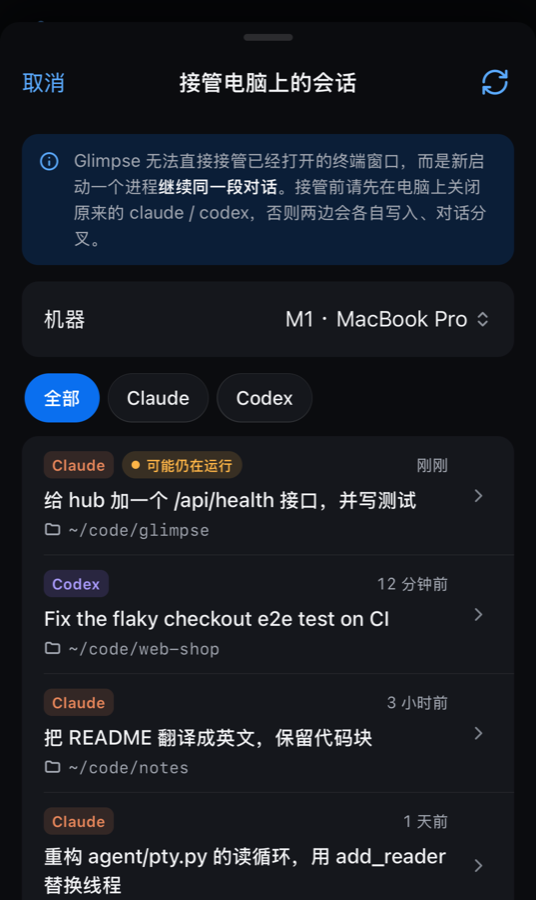
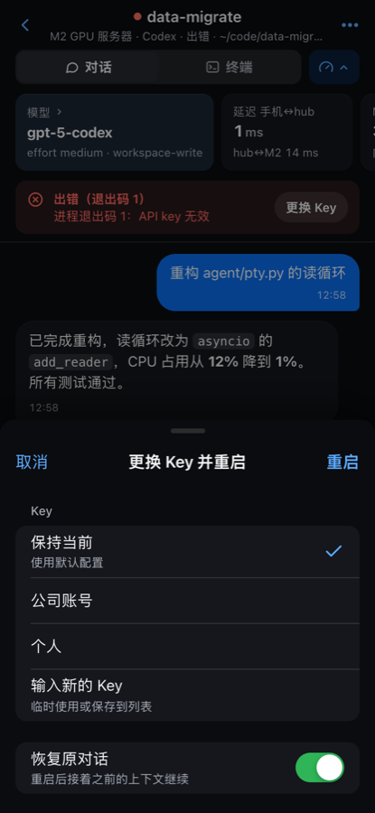
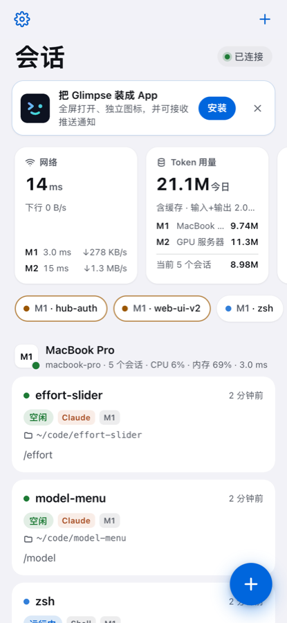

<div align="center">



# Glimpse

<p>
  
  
  
  
</p>

**在手机上查看和操作你电脑、开发机里正在跑的 Claude Code / Codex 会话。**

实时同步输出 · 手机上直接回复和授权 · 完成 / 出错 / 提问时推送通知 · 多机器多会话标签页

[English](README.md) · **简体中文**

[快速开始](#快速开始) · [工作原理](#工作原理) · [配置](#配置) · [安全](#安全) · [FAQ](#faq)

   

</div>

## 为什么需要它

你在 Mac 上跑着 Codex，又在开发机上跑着 Claude Code，然后出门吃饭了。它们现在进行到哪一步？是不是卡在一个权限确认上？是不是已经报错退出了？

Glimpse 让手机变成这些会话的遥控器。手机上看到的就是它们真实的终端，不是另一套模拟环境。

## 功能

- **多会话标签页**：所有机器上的会话集中显示。每个会话带机器编号（M1、M2…）、任务名、工作目录、运行状态和最后一条回复。
- **两种视图**：
  - “对话”视图：根据 Claude Code / Codex 的会话记录渲染成聊天气泡，工具调用和输出可以展开。
  - “终端”视图：基于 xterm.js 显示完整的终端画面。
- **手机上输入**：输入框发送的文字会提交到该会话的进程。另有 Esc、^C、Tab、方向键、1/2/3 等快捷键。
- **对话视图里操作 TUI 菜单**：终端里弹出 `/model`、`/effort` 等交互菜单时，对话视图会显示成菜单卡片，选项是大按钮（标出当前值和光标），另有 Esc，Claude 还有“s · 仅本会话”。输入框旁的“/”按钮可以直接输入常用命令（`/model`、`/effort`、`/compact`、`/clear`、`/status`）。
- **一键授权**：Claude Code 请求权限时，手机上会出现授权卡片，可以直接点允许、总是允许、拒绝或者交给终端处理。底层走官方的 `PermissionRequest` hook，不靠模拟按键。
- **回答提问**：`AskUserQuestion` 的选项会显示成按钮。
- **推送通知**：本轮完成、出错停止、需要授权或回答问题、进程退出时，通过标准 Web Push 发通知到 iPhone。
- **更换 Key 并重启**：Key 余额用完时，可以在手机上换一个 Key，结束旧进程后重新启动并恢复原对话（`claude --resume` / `codex resume`）。
- **模型与模式**：
  - 选择列表来自各机器的真实数据：Codex 的模型和推理强度取自 `codex debug models`；Claude 的模型是 default / opus / sonnet / haiku / fable / opusplan，并显示 `--settings` 文件里配置的自定义模型名。列表缓存 10 分钟。
  - Claude Code：权限模式（manual / acceptEdits / auto / plan / dontAsk / bypassPermissions）、`/model`、推理强度（low / medium / high / xhigh / max / ultracode）和 `/goal`。`ultracode` 会先用 `--effort xhigh` 启动，再执行 `/effort ultracode`。
  - Codex：模型、推理强度（low / medium / high / xhigh / max / ultra，以模型支持为准）、审批策略和沙箱，改完会重启并恢复对话。
  - 这些在新建会话时也能直接选。
- **接管电脑上的会话**：列出这台机器上最近的 Claude / Codex 对话，选中后 Glimpse 用 `--resume` / `codex resume` 接着这段对话继续。
- **删除会话**：会话卡片左滑，或在“会话操作”里删除。正在运行的会先结束进程。另有一键清理已结束的会话。
- **在手机上管理机器**：添加、编辑、删除 SSH 机器并测试连接。用的是 hub 电脑已有的 SSH 密钥，主机名会做校验。
- **插件**：首页和会话页可以显示：
  - 网络延迟与速率
  - Token 用量，包括每台机器**今日总用量**（统计这台机器上所有 Claude / Codex 记录）
  - 上下文占用、模型与模式
  - 机器 CPU 和内存
  - 活跃会话统计

  每个插件都可以开关和调整顺序。
- **进程不受连接影响**：会话由 agent 守护进程托管（原理同 tmux）。hub 重启、ssh 断线、手机锁屏都不会中断 AI 进程，重连后从断点续传输出。
- **电脑和手机同时操作**：`./glimpse run claude` 把电脑终端接到同一个会话上，按 `Ctrl-]` 断开。
- **浅色 / 深色**：设置 → 外观里可选“跟随系统 · 浅色 · 深色”。终端视图始终是深色。

<p align="center">   </p>

## 工作原理

```
 手机或任意浏览器（安装为 PWA）
    │  HTTPS + WebSocket，经 Tailscale（WireGuard 加密，能打洞时点对点直连）
    ▼
 hub（常开的那台电脑，hub/server.py）
    │  每台机器一条 stdio JSON 通道：本机直接起子进程，开发机走 ssh（复用 ~/.ssh/config）
    ▼
 agent（agent/glimpse_agent.py，纯标准库）
    └─ 用 PTY 托管 claude / codex 进程，并读取它们的 hooks 与会话记录
```

- **为什么用 Tailscale，而不是内网穿透或中继服务器**：手机和电脑在同一个 tailnet 里能直接打洞，链路上没有第三方中转，延迟基本等于网络 RTT，也不需要开放任何公网端口。Tailscale 还免费签发 `*.ts.net` 的 HTTPS 证书，iPhone 的 Web Push 必须走 HTTPS 才能用。
- **开发机不需要装任何东西**：hub 通过 ssh 把 agent 源码从 stdin 发过去，在内存里 `exec`，远端不安装任何代码。
  - 唯一会写的是每个会话临时的 Claude settings 文件（`0600`，放在私有临时目录，进程退出就删）。
  - 远端只需要 `python3`（3.8 以上），并且能用 ssh 免密登录。
  - 开发机也不需要装 Tailscale。
- **状态检测**：
  - Claude Code：通过启动时注入的 hooks（`SessionStart`、`UserPromptSubmit`、`PreToolUse`、`PermissionRequest`、`Notification`、`Stop`、`StopFailure` 等）判断状态，内容来自 transcript JSONL。
  - Codex：读取 rollout JSONL（`task_started`、`task_complete`、`token_count` 等）和终端的 OSC 9 通知。
- **手机上只用浏览器**：不需要应用商店、描述文件或证书，不越狱，不侧载。

## 快速开始

### 前置条件

| 设备 | 需要 |
| --- | --- |
| hub（常开的电脑，macOS 或 Linux） | Python 3.9+、[Tailscale](https://tailscale.com/download)，并在 admin console 开启 MagicDNS 和 HTTPS Certificates |
| 每台开发机 | `python3`，hub 能 `ssh <host>` 免密登录 |
| 手机 / 其他设备 | Tailscale App，并登录同一个 tailnet。iPhone 推送需要 iOS 16.4+；Android、电脑上的 Chrome / Edge / Safari 都能用 |

### 1. 安装

```sh
git clone https://github.com/lyfeng001/Glimpse.git
cd Glimpse
./glimpse setup            # 创建 .venv、安装依赖，并从 config.example.json 生成 config.json
```

### 2. 配置

编辑 `config.json`（字段说明见[配置](#配置)）：

- `hub.listen` 和 `hub.tailscale_hostname` 默认是 `"auto"`，会自动使用这台电脑的 Tailscale IP 和 MagicDNS 名称。
- `keys` 和 `machines` 填你的 API Key 和要监控的机器。机器之后也可以在手机上添加。

### 3. 启动 hub

```sh
./glimpse hub                    # 前台运行，首次启动会自动用 tailscale cert 申请 HTTPS 证书
scripts/install_launchd.sh       # 可选（macOS）：开机自启，挂了自动拉起
```

### 4. 在手机上打开

1. 打开 Tailscale App 并保持连接。
2. 在电脑上运行 `./glimpse url`，用手机浏览器打开输出的链接（链接里带访问令牌，不要分享）。
3. 安装为 App（见[作为 App 使用](#作为-app-使用)），之后都从图标打开。
4. 进入 ⚙︎ 设置，点“开启通知”并允许，再点“发送测试通知”确认能收到。

### 5. 开始一个会话

- **在手机上**：点 ＋，选择机器、类型（Claude Code / Codex / Shell）、Key 和工作目录。
- **在电脑上**：运行 `./glimpse run claude` 或 `./glimpse run codex`。当前终端会接入同一个会话，`Ctrl-]` 断开，`./glimpse attach <id>` 重新接入，不带 id 时接入最近的会话。在 hub 电脑上也能接入其他机器上的会话（`./glimpse attach M2:<id>`，经 hub 转发）。手机“会话操作”里会显示具体命令，以及给其他浏览器用的链接。`./glimpse ls` 列出所有会话。`--` 之后的参数会原样传给工具，例如 `./glimpse run claude -- --model sonnet`。
  - 它使用 `config.json` 里这台机器的预设（argv 和默认 Key，与手机端一致）。`-k/--key 名称` 换用其他 Key，`--key none` 不用 Key。终端里只显示 Key 的名称，不显示值。
  - `./glimpse run claude --resume <id>` 继续一段对话。如果这段对话已经在某个 Glimpse 会话里，会直接接入那个会话（已结束的会原地重启），不会再开一个副本。

- **Shell 集成（继续敲原来的命令）**：在 hub 电脑的 `~/.zshrc`（或 `~/.bashrc`）里加一行：

  ```sh
  eval "$(/path/to/Glimpse/glimpse shell-init)"
  ```

  之后直接敲原来的命令就会以 Glimpse 会话运行，当前终端照常接入，手机上同时能看到：

  ```sh
  codex resume 01a0edaf-75de-7bd2-b706-c991c4118ecb --no-daemon
  claude --resume <id>
  claude
  ```

  - 会套用这台机器的预设：Codex 自动导出预设的 Key，Claude 照常用预设的 settings 文件启动。`GLIMPSE_KEY=key2 codex ...` 可以临时换 Key。
  - 这段对话如果已经在某个 Glimpse 会话里，会直接接入，不会再开一个。
  - 非交互的用法（`claude -p`、`codex exec`、`--version`、`mcp` 等子命令、管道和脚本）会直接运行原程序。`GLIMPSE=0 codex ...` 或 `command codex ...` 总是绕过 Glimpse。

> 直接在别的终端里启动的 claude / codex，Glimpse 无法原样接管，因为那个终端不归它管。想在手机上继续的话，先在原终端退出，再在手机上打开“接管电脑上的会话”选中那段对话，Glimpse 会用 `--resume` / `codex resume` 接着继续。

## 作为 App 使用

Glimpse 是一个 PWA。安装后从自己的图标全屏打开，没有浏览器地址栏，可以收推送通知。

| 设备 | 安装方式 |
| --- | --- |
| iPhone / iPad | 用 Safari 打开链接 →“分享 → 添加到主屏幕”。推送需要 iOS 16.4+，并且要在安装后的 App 里开启 |
| Android | Chrome →“⋮ → 安装应用”（Glimpse 也会弹出“安装 App”按钮） |
| Mac / Windows / Linux | Chrome 或 Edge：点地址栏的安装图标。macOS 上的 Safari：“文件 → 添加到程序坞” |

没有 App Store 版本。安装后的网页 App 就是 Glimpse 的 App 形态，各平台都一样，tailnet 里的任何电脑也都能用。

## 配置

所有配置（包括 Key 等隐私信息）都放在同一个文件 `config.json` 里。它已在 `.gitignore` 中，权限是 `0600`。仓库里的 [`config.example.json`](config.example.json) 是示例模板。

```jsonc
{
  "hub": {
    "listen": [{"host": "auto", "port": 8443}, {"host": "127.0.0.1", "port": 8443}],   // auto = 本机 Tailscale IP
    "tailscale_hostname": "auto",    // 或 your-mac.your-tailnet.ts.net
    "caffeinate": true,              // macOS：hub 运行期间阻止空闲休眠
    "push_subject": "mailto:you@example.com",
    "approval_wait_seconds": 600     // 手机多久没处理授权，就交回终端
  },
  "keys": {
    // 同一个 Key 值，hub 会按会话类型映射成不同的变量
    "env": {"claude": "ANTHROPIC_AUTH_TOKEN", "codex": "OPENAI_API_KEY"},
    "profiles": [{"name": "key1", "value": "sk-..."}]
  },
  "machines": [
    {"id": "M1", "name": "mac", "type": "local", "default_cwd": "~/code",
     "presets": {
       "claude": {"argv": ["claude", "--settings", "~/.claude/my-settings.json"], "key": null},
       "codex":  {"argv": ["codex"], "key": "key1"}
     }},
    {"id": "M2", "name": "devbox", "type": "ssh", "host": "devbox", "default_cwd": "~"}
  ]
}
```

**Key 的注入方式**

- **Claude Code**：始终通过 `--settings` 文件启动。Glimpse 读取 preset 里你自己的 settings 文件，把选中的 Key 写进它的 `env`，再加上 Glimpse 的 hooks，合并成一个临时文件（`0600`，进程退出后删除）。Key 不会出现在进程环境变量或命令行参数里。
- **Codex**：以环境变量的方式注入（相当于 `export OPENAI_API_KEY=...`），变量名在 `keys.env.codex` 里配置。注入发生在 shell 的 rc 文件执行之后，所以 `~/.bashrc` 里写死的旧 Key 不会把它覆盖。如果你的 Codex 需要额外参数（例如 `--no-daemon`），直接写进 `argv`。

## 安全

- hub 只监听 `hub.listen` 里的地址（默认是 Tailscale IP 和 `127.0.0.1`），局域网和公网都访问不到。每个请求还要校验 192 位随机访问令牌（`data/token`）：
  - 令牌存在 `HttpOnly; Secure; SameSite=Strict` 的 cookie 里，比较时用常数时间；
  - 拒绝来自其他来源的 WebSocket 连接；
  - 令牌不会写进日志。
- 浏览器只拿得到 Key 的名字。Key 值只存在于 hub 的 `config.json`（原子写入，`0600`）和启动用的临时文件里。启动命令行也不会发给手机。
- agent 的 Unix socket 权限是 `0600`。Linux 抽象 socket 会双向校验 `SO_PEERCRED`：只允许同一个 uid 连接，别的用户抢占的 socket 也会被拒绝。
- 手机上添加机器时只接受普通的 SSH 主机名或别名。hub 用 `BatchMode=yes` 和自己的密钥连接，从不使用密码。
- `data/` 下的令牌、VAPID 私钥、推送订阅、证书私钥都是 `0600`。
- 作废旧令牌：删除 `data/token`，重启 hub，用新的 `./glimpse url` 重新登录。

## FAQ

<details><summary><b>手机和电脑都要装吗？</b></summary>

电脑（hub）上运行本项目。手机只需要 Tailscale App 和浏览器，开发机什么都不用装。
</details>

<details><summary><b>只有 iPhone 能用吗？安卓或者其他电脑呢？</b></summary>

在 tailnet 里、有现代浏览器的设备都能用，包括 Android、iPad，以及其他 Mac / Windows / Linux 电脑。打开同一个链接，用令牌登录即可。Android 上的 Chrome，以及电脑上的 Chrome、Edge、Safari 也都支持推送通知。
</details>

<details><summary><b>标志是什么意思？</b></summary>

一个用终端字符画出来的眨眼笑脸：`>` 和一个点是两只眼睛，光标线弯成了微笑。意思是不管在哪，都能轻松“瞥一眼”（glimpse）你的终端。
</details>

<details><summary><b>会影响我的 iPhone 吗？</b></summary>

不会。它只是一个添加到主屏幕的网页，不需要描述文件、证书、越狱或侧载。删除主屏幕图标就完全清除了。
</details>

<details><summary><b>没收到通知？</b></summary>

- 必须从主屏幕图标打开页面，才能在设置里开启通知。
- iPhone 设置 → 通知 → Glimpse 里要允许通知。
- hub 必须是 HTTPS（`tailscale_hostname` 已配置，证书申请成功）。
- 手机打开 Glimpse 并停留在前台时，只显示应用内横幅，不推送系统通知。
</details>

<details><summary><b>Mac 合盖后还能用吗？</b></summary>

hub 运行期间会通过 `caffeinate -i` 阻止空闲休眠，但合盖一般仍会休眠，除非接着电源和外接显示器。如果有常开的 Linux 开发机，也可以把 hub 跑在那上面。
</details>

<details><summary><b>授权卡片和终端里的对话框，以哪个为准？</b></summary>

先处理的那个为准。手机上点了允许或拒绝，Claude 会直接得到结果。手机上点“在终端处理”、在终端里按了任意键、或者超过 `approval_wait_seconds` 没处理，都会交回 Claude 自己的对话框。
</details>

## 开发

```sh
./glimpse test               # 单元测试 + hub 集成测试（含 RFC 8291 Web Push 官方向量）
./glimpse hub -v             # 详细日志
GLIMPSE_DEBUG=1 ./glimpse hub   # agent 记录 hook 事件和启动命令到 data/agent/agent.log
```

目录结构：

```
agent/glimpse_agent.py   PTY 守护进程、hooks 中继、transcript 解析、CLI（纯标准库，可在远端内存中运行）
hub/server.py            HTTPS + WebSocket 服务、鉴权、推送、机器管理
hub/machines.py          到各台机器的 stdio 通道（本地子进程 / ssh）
hub/webpush.py           Web Push（RFC 8291 加密 + RFC 8292 VAPID），无第三方依赖
hub/config.py            配置加载
hub/attach_client.py     经 hub 实现 `./glimpse attach`（接入其他机器上的会话）
web/                     PWA（原生 JS + xterm.js，无构建步骤）；web/icon.svg 是标志源文件（PNG 由它生成）
```

## 致谢

- [xterm.js](https://xtermjs.org/)（MIT），手机端的终端渲染
- [Tailscale](https://tailscale.com/)，组网和 HTTPS 证书
- 交互设计参考了 [Moshi](https://getmoshi.app/) 与 [Happier](https://github.com/happier-dev/happier)
